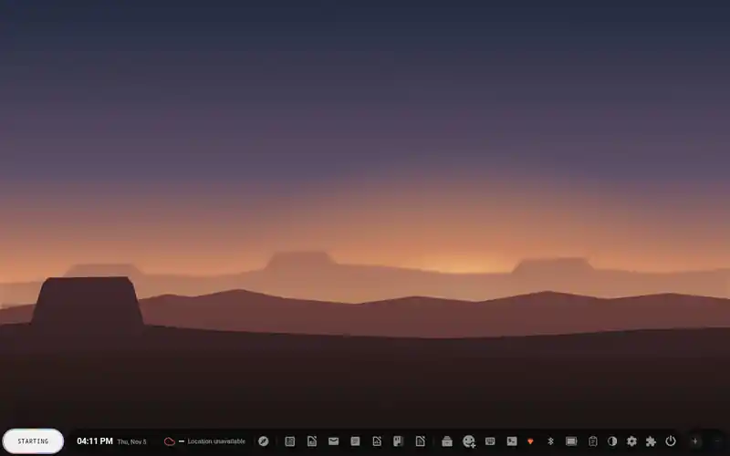
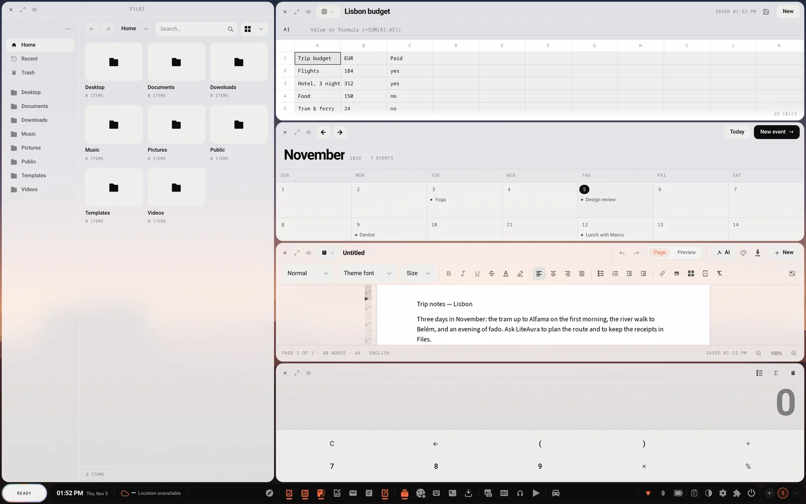
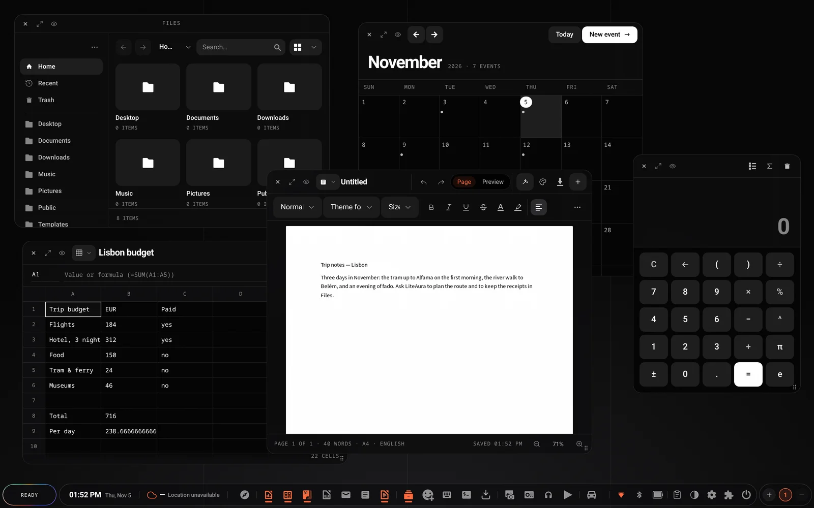
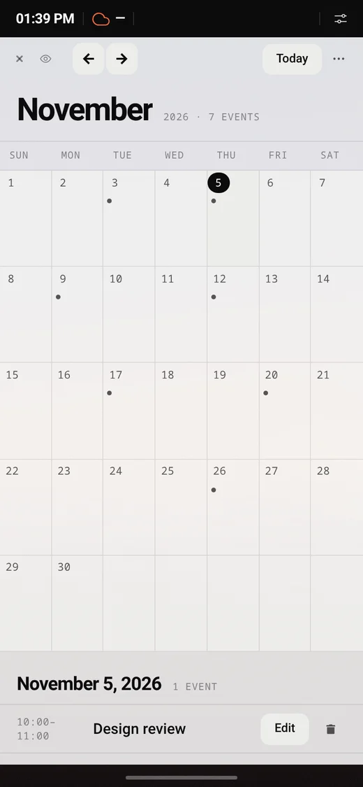
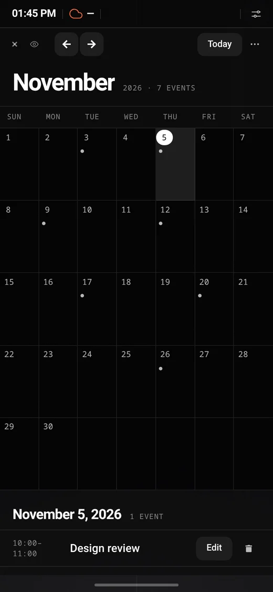

# LiteAura

**LiteAura is a local-first AI assistant you talk to, wrapped in a desktop.**
Say "Hey, Laura" (or press the voice bar) and a conversational agent running on
your own machine (Ollama) answers out loud, opens windows, writes documents and
drives its apps. Around it is a complete desktop shell — windows across
workspaces, a top bar with the system's controls, a phone layout, a wearable
watch face, a lock screen, its own login screen — and every app beyond the
assistant is a **self-contained plugin** you can add or remove while it runs.

<p align="center">
  <a href="docs/screenshots/liteaura-tour.mp4"></a>
</p>
<p align="center"><sub><b>Desktop · Phone · Wearable.</b> Asked in the chat, the assistant writes a guide in Word and a budget in Calc, opening each window — then the three window layouts, the overview and the themes; the same apps on a phone; and the wearable face, where the assistant's dots fill the screen. Recorded with <code>gemma4:31b-cloud</code> through Ollama; the model's thinking time is sped up, and the wearable's spoken requests are played as a demo. <a href="docs/screenshots/liteaura-tour.mp4">Full video (MP4, 1080p)</a></sub></p>

| Tiling · Dusk | Free windows · Ink |
|---|---|
|  |  |

<p align="center">
  
  &nbsp;
  
</p>
<p align="center"><sub>On a phone: a status bar, one window at a time and a single bottom bar. The two built-in themes are <b>Dusk</b> (default, light windows) and <b>Ink</b> (near-black).</sub></p>

> The repository, the server binary and some crates are still called `shiny`:
> that is the core's internal name. The product, the kiosk shell (`liteaura`),
> the Debian package and the APT suite are LiteAura.

```
LiteAura shell (Qt WebEngine)  /  any browser       shiny (core server)
┌──────────────────────────────┐               ┌───────────────────────────────────────┐
│ desktop · top bar · windows   │     HTTP/SSE  │ agent loop (Ollama) · plugin dispatch  │
│ voice bar · chat · settings   │◀────────────▶ │ voice (Whisper/Vosk + Supertonic TTS)  │
│ phone layout · lock screen    │               │ auth (PAM) · SQLite · host panels      │
└──────────────────────────────┘               └───────────────┬───────────────────────┘
                                                               │ dlopen (cdylib)
                                                 Plugin: tools · routes · schema · window
```

---

## Highlights

**Assistant**
- An agent loop on Ollama: talk or type, get spoken and written replies. The
  assistant is called **Laura** by default ("Hey, Laura"); the name is yours to
  change in Settings → Assistant.
- **faster-whisper** streaming speech recognition (Vosk in the browser as a
  fallback, and for the wake word) and **Supertonic 3** voices (optional
  **Qwen3-TTS**), all local.
- Resumable conversations, Markdown replies, an artifact dock, web search,
  notifications, and a thinking toggle for reasoning models.
- The agent drives the desktop and every plugin through tools (open, arrange,
  focus windows; create documents, events, routes, music…).
- **"No slop"**: the AI can be switched off entirely — no chat, no agent, no
  voice — and the desktop keeps working on its own.

**Desktop**
- Three ways to arrange windows — **Tiling**, **Columns** and free
  **Windows** — across workspaces, a grid **overview**, focus mode and
  keyboard shortcuts.
- A top bar with clock, weather, the plugin tray and the system chips (sound,
  network, Bluetooth, battery, power).
- A **lock screen** (idle time, before suspend, `Super+L`) and an editorial
  sign-in screen, in the user's motion settings.
- Two themes, **Dusk** and **Ink**, one accent colour and gradient of your
  choice, selectable icon sets and wallpapers.
- Every string translated in **26 languages**.

**On a phone**
- A status bar and a control centre, one window at a time, a single bottom bar
  with gestures, and window bars that fold their controls into a menu.

**Updates without a restart**
- Plugins whose files change are loaded again while the server runs; the
  server swaps itself for a new binary without closing its port; the page
  reloads only what changed and restores every window. The kiosk shell, the
  one piece that needs a relaunch, does it behind the next locked screen
  ([Live update](docs/core/live-update.md)).

**The machine**
- Linux host integration: PipeWire sound, NetworkManager Wi-Fi, BlueZ
  Bluetooth, battery, logind power actions, display scale, backlights — each
  optional and hidden when its daemon is absent.
- Native shells: `liteaura` (Qt WebEngine, Linux) and `liteaura-mac`
  (WKWebView + Touch Bar).
- **Its own login screen** for real Linux accounts (PAM), with one server per
  account — no display manager needed (`sudo liteaura-seat enable`).
- Remote access over **Iroh** (peer to peer) or **Tailscale Funnel**, with host
  controls kept local, and a web client for other devices.
- A live ISO with a graphical installer, including Apple T2 MacBooks.

---

## Quick start

See **[Getting started](docs/getting-started.md)** for the full guide.

```bash
git clone https://github.com/askscience/shiny.git
cd shiny

# Optional: create a .env (see docs/configuration.md).

# TTS sidecar (or set AUTO_START_SUPERTONIC=true):
./voice/start_supertonic.sh
# STT defaults to faster-whisper; the server starts its sidecar automatically.
./voice/start_whisper.sh --install

cargo run
```

Open <http://localhost:8080> (defaults from `SERVER_HOST`/`SERVER_PORT`).
Microphone access needs HTTPS unless you connect over `localhost`.

**Prerequisites:** Rust, system SQLite, Python 3.9+ (`supertonic[serve]` +
`faster-whisper`), and optionally Ollama, GPSD, PipeWire, BlueZ, ffmpeg, CMake
+ `nasm` (the Browser's TLS client).

## Packages

Each release tag (`v*`) builds the `liteaura` Debian package, publishes the signed
APT repository to <https://askscience.github.io/shiny/apt/>, and creates a
GitHub Release with the `.deb`. Ordinary pushes do not build packages.

### Add the APT repository

The repository is signed. Add its public key and the `liteaura` suite once:

```sh
sudo curl -fsSL https://askscience.github.io/shiny/apt/liteaura-archive.gpg \
  -o /usr/share/keyrings/liteaura-archive.gpg
echo 'deb [signed-by=/usr/share/keyrings/liteaura-archive.gpg] https://askscience.github.io/shiny/apt/ liteaura main' \
  | sudo tee /etc/apt/sources.list.d/liteaura.list
sudo apt update
```

The suite is called `liteaura`, not a Debian codename. Then install or upgrade:

```sh
sudo apt install liteaura   # first install
sudo apt upgrade            # later updates
```

The package brings LiteAura's own login screen but does not switch it on, so
it never takes over a desktop's existing login. To make LiteAura the machine's
login screen (it disables the display manager):

```sh
sudo liteaura-seat enable
```

The same key is available in
[`packaging/liteaura-archive.gpg`](packaging/liteaura-archive.gpg) and in the
`liteaura-archive-keyring` package, so a checkout or the live image can install it
offline. Tag a version (for example `v0.2.0`) to cut a release; the tag is the
package version. See [Debian package and APT repository](docs/deployment/packages.md)
for the workflow, versioning and signing-key details.

---

## Plugins

Every plugin is optional and activated **per user**. Activating one registers its
agent tools and skills, mounts its routes, runs its migrations and opens its
window. In the multi-user install plugins are also **installed per user**
(`PLUGINS_DIR` under the account's data dir) over a read-only system baseline
(`SYSTEM_PLUGINS_DIR`); a user plugin of the same name overrides the baseline.

| Plugin | Category | Adds |
|---|---|---|
| `browser` | Web | Ad-filtered web window, child web views, downloads, incognito, news shelf. |
| `files` | System | File browser over the user's home + the shared save/open helpers. |
| `terminal` | System | A real PTY login shell rendered with xterm.js, and a `terminal_exec` agent tool that runs commands in it. |
| `keyboard` | System | Virtual multi-language on-screen keyboard (8 layouts). |
| `hello` | System | Minimal plugin-authoring example (one tool). |
| `updates` | System | System + Ollama updates for every major distro, with a top-bar chip; applied without a restart. |
| `installer` | System | The live session's disk installer (partitioning, account, AI tier). |
| `traveler` | Travel | 22 trip/GPS/map/navigation/diary/planning/artifact tools. |
| `word` | Office | Word processor storing real `.odt` documents. |
| `calc` | Office | Spreadsheets with live formulas and `.ods` import/export. |
| `impress` | Office | Slide decks with transitions, exported as `.odp`. |
| `pdf` | Office | PDF viewer/editor: render, edit text, annotate, watermark, merge. |
| `mail` | Office | IMAP inbox + SMTP compose with a local cache. |
| `calendar` | Office | Events in a month grid, with start-soon notifications. |
| `calculator` | Office | Basic/scientific math sharing one evaluator with the window. |
| `image` | Media | Layered raster editor (blend modes, filters, painting, selection). |
| `studio` | Media | DAW-grade sequencer + synth; renders to WAV on a self-contained DSP engine. |
| `capture` | Media | Screen, window or region recording with a webcam bubble, live streaming to YouTube, Twitch, Kick, Facebook and RTMP, and a video editor the assistant drives. |
| `radio` | Media | Internet radio via Radio Browser. |
| `youtube` | Media | Search and watch videos, with a built-in recommender. |

Each plugin has its own documentation in [`plugins/<name>/docs/`](plugins) (for
example [`plugins/files/docs/README.md`](plugins/files/docs/README.md)).

### Craft apps

The Plugins window's **Craft apps** tab is a store for the
[Craft App Suite](https://getartcraft.com/apps) (PhotoCraft, FilmCraft,
WordCraft, PdfCraft, …). New apps join it on their own: once a day it reads
the suite's release feeds. It lists each app from the catalog, installs
that app's own **web build** from its GitHub release — verified against the
release's SHA-256 — as a web-app plugin (`kind = "web"`, served at
`/plugins/<id>/` and mounted in a window as an iframe), and keeps it updated.
Each app comes with its **AI control** already: the app's command-line tool (a
Model Context Protocol server, shipped in the same release) installs alongside
the web build, on by default — no separate switch to find. An app's **open
window** is what puts its tools in the turn; focus mode narrows that to the apps
the user is focused on, a rule the core enforces, not the prompt. When the app's
build exposes its page control channel, the agent drives the **window itself**
and changes appear live; without it, it works headless and hands you a saved
file. The switch on the app's card turns AI control off (and frees the 60–124 MB);
that choice survives later updates.
The catalog and the release rules follow
[ArtCraft Launcher](https://github.com/storytold/craft-launcher) (MIT OR
Apache-2.0, © ArtCraft Team and contributors).

---

## Documentation

The full documentation lives in **[`docs/`](docs/README.md)**:

| Area | Start here |
|---|---|
| Orientation | [Getting started](docs/getting-started.md) · [Architecture](docs/architecture.md) · [Configuration](docs/configuration.md) |
| Core | [Agent](docs/core/agent.md) · [Chat](docs/core/chat.md) · [Voice](docs/core/voice.md) · [Desktop](docs/core/desktop.md) · [Web UI](docs/core/web-ui.md) · [Themes & icons](docs/core/themes-icons.md) · [Data & auth](docs/core/data-and-auth.md) · [Travel](docs/core/travel.md) · [Live update](docs/core/live-update.md) |
| Host | [Overview](docs/host/README.md) · [Audio](docs/host/audio.md) · [Bluetooth](docs/host/bluetooth.md) · [Battery & power](docs/host/battery-power.md) · [Network](docs/host/network.md) · [Display & input](docs/host/display-input.md) |
| API | [Index](docs/api/README.md) · [Auth](docs/api/auth.md) · [Chat & agent](docs/api/chat-agent.md) · [Voice](docs/api/voice.md) · [Host](docs/api/host.md) · [Travel](docs/api/travel.md) |
| Deployment | [Overview](docs/deployment/README.md) · [Sidecars](docs/deployment/sidecars.md) · [Multi-user Linux](docs/deployment/multi-user-linux.md) · [Remote access](docs/deployment/remote-access.md) · [Kiosk shell](docs/deployment/kiosk-shell.md) · [T2 Mac](docs/deployment/t2-mac.md) |
| Plugins | [Plugin system](docs/plugins/README.md) · [Authoring](docs/plugins/authoring.md) · [API reference](docs/plugins/reference.md) · [Runtime & ABI](docs/plugins/runtime-abi.md) |
| Reference | [Crate map](docs/reference/crate-map.md) · [Env vars](docs/reference/env-vars.md) · [Glossary](docs/reference/glossary.md) |

---

## Project layout

```
src/                          # core server (shiny): agent, auth, host panels, plugin host
crates/
  shiny-plugin-sdk/           # the plugin API + ODT/ODS/ODP codecs + shared clients
  shiny-filter/ + -core/      # the Browser's in-process ad/tracker filtering engine
  liteaura/ · liteaura-mac/   # Linux / macOS native shells
  liteaura-core/              # state shared by both shells
  shiny-auth/                 # root PAM helper (password checks, starts sessions)
  shiny-installer-*/          # the live installer's helper and protocol
  shiny-iroh-client/ · shiny-iroh-proto/ · shiny-server-mode/
plugins/<name>/               # 19 self-contained plugins, each with docs/
migrations/                   # core SQL migrations (001..013)
web/                          # browser UI: ui/ (library), themes/, js/, vendor/
liteaura-web/                 # the web client for remote devices (GitHub Pages)
packaging/                    # signing key, Gokapi, the packaged login screen (seat/)
voice/                        # speech sidecars and model tooling
scripts/                      # deb/ISO builds, session scripts, installers
greeter/                      # optional LightDM theme
docs/                         # this documentation (screenshots in docs/screenshots)
```

See the [crate map](docs/reference/crate-map.md) for every crate.

---

## Tech stack

| Concern | Choice |
|---|---|
| HTTP | [axum](https://crates.io/crates/axum) 0.7, router hot-swapped via `arc-swap` |
| Database | [sqlx](https://crates.io/crates/sqlx) + **system** SQLite |
| HTTP client | `reqwest` (rustls); `wreq` (BoringSSL, Chrome TLS) for the Browser |
| Async | [tokio](https://crates.io/crates/tokio) |
| Plugin loading | `libloading` (dlopen cdylibs) |
| Studio DSP | `fundsp` + `rustysynth` |
| Host (Linux) | `nmrs`, `zbus`, `if-addrs`, `libc` |
| Remote | `iroh` (optional feature) + Tailscale CLI |

---

## Development

```bash
cargo run                          # dev server
cargo build --release --workspace  # server + all plugins
cargo build --features iroh        # include remote access
cargo check                        # compile check
```

Plugin development: [docs/plugins/authoring.md](docs/plugins/authoring.md).
Editing a plugin window? The app serves the **installed** copy
(`data/plugins/<name>/web/`, or the account's `~/.local/share/shiny/plugins/`),
not `plugins/<name>/web/`. Web files can simply be copied there; a rebuilt
library goes in with `scripts/install-plugin-dev.sh <name>`, which writes a
new file and renames it over the old one. The server reloads a changed plugin
within ten seconds and open windows pick it up, no restart. Never `cp` a
`.so` over the one that is loaded: the running server maps that file, and
rewriting it in place crashes the server (segmentation fault).

---

## License

See [LICENSE](LICENSE). Bundled KDE icon artwork is GPL-3.0; see
[`docs/core/themes-icons.md`](docs/core/themes-icons.md).
